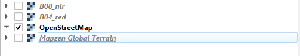
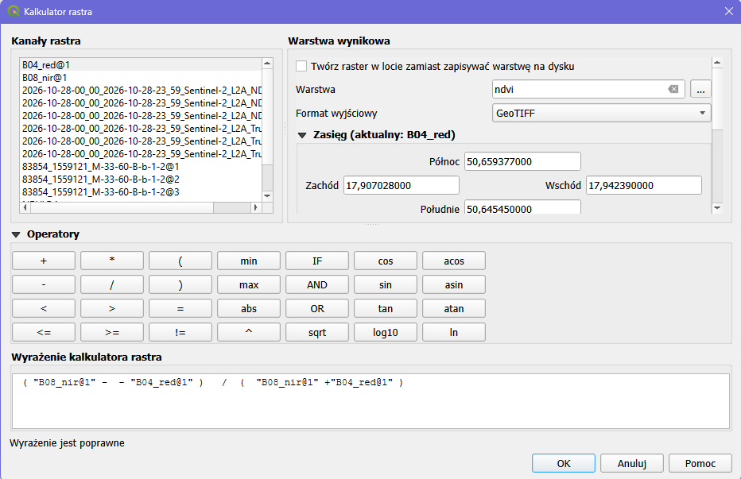
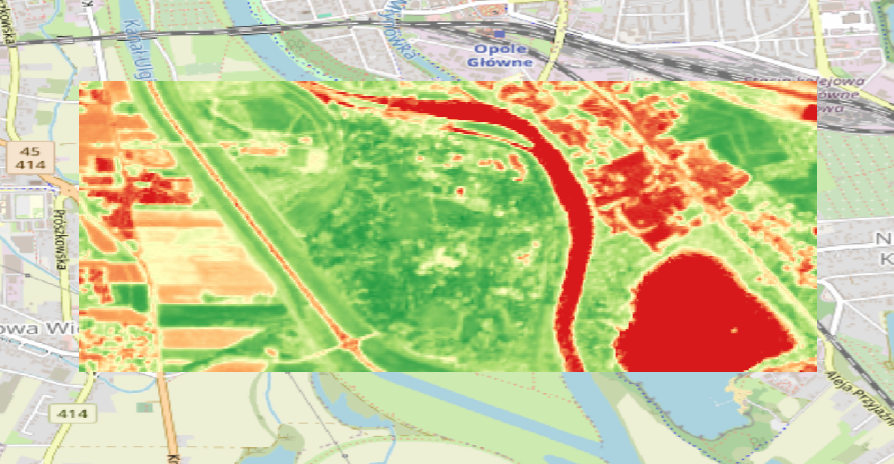
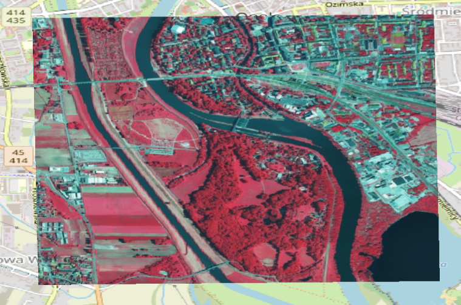
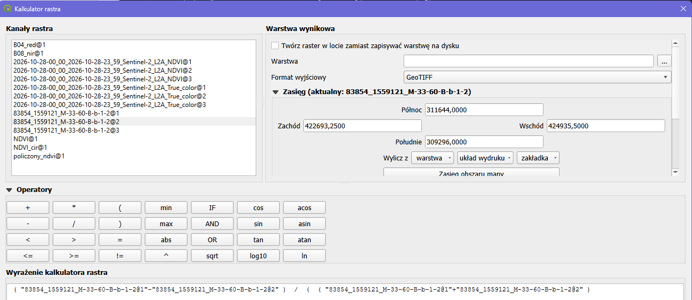
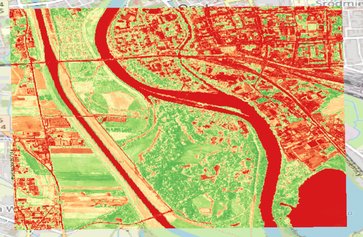
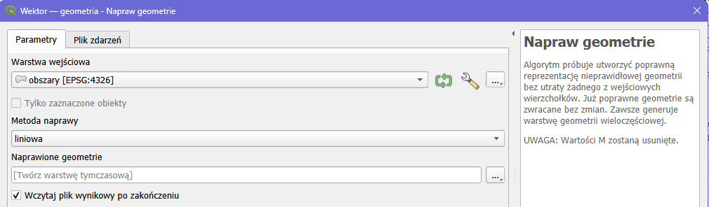
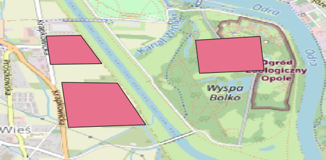
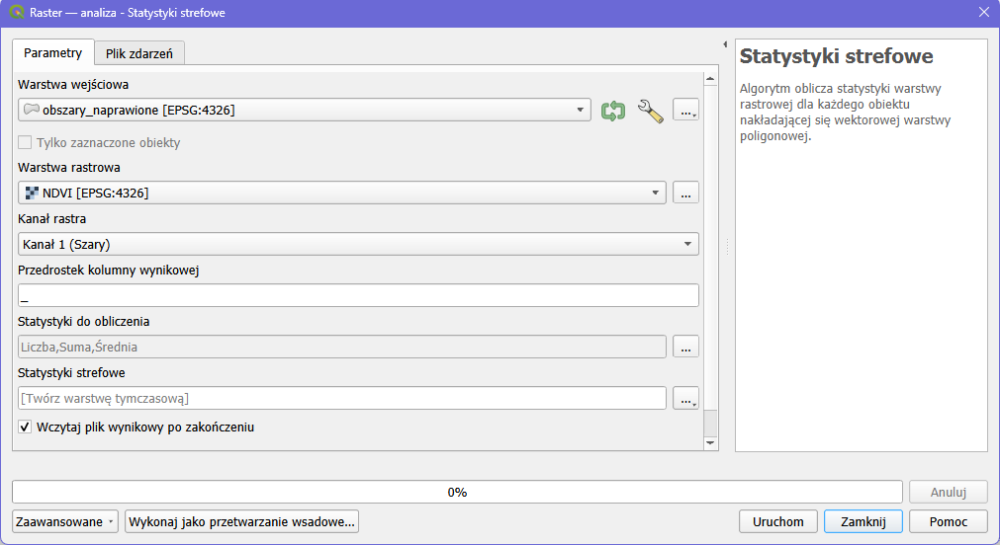
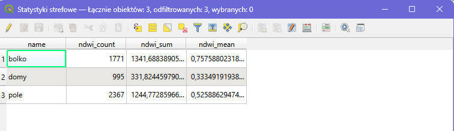

# Sprawozdanie -- obliczanie wskaźnika NDVI w QGIS

## 1. Cel ćwiczenia

Celem ćwiczenia było obliczenie wskaźnika NDVI na podstawie danych
satelitarnych oraz ortofotomapy CIR. Następnie wykonano wizualizację
wyników i analizę statystyczną dla wybranych obszarów.

## 2. Obliczanie NDVI z danych B04 i B08

Na początku utworzono nowy projekt w programie QGIS i dodano mapę
podkładową. Następnie wczytano rastry B04 (kanał czerwony -- RED) oraz
B08 (bliska podczerwień -- NIR). Dla ułatwienia zmieniono nazwy warstw.

W Kalkulatorze rastra obliczono wskaźnik NDVI, korzystając ze wzoru:

NDVI = (NIR - RED)(NIR + RED)

Wartości NDVI mieszczą się zazwyczaj w przedziale od -1 do 1. Wyższe
wartości wskazują na bardziej rozwiniętą i zdrową roślinność, natomiast
wartości bliskie zeru lub ujemne mogą oznaczać między innymi zabudowę,
wodę lub odkrytą glebę.

Po obliczeniu utworzono warstwę NDVI. W jej właściwościach, w zakładce
*Symbologia*, wybrano typ renderowania *Singleband pseudocolor* i
ustawiono skalę kolorów, aby lepiej zobrazować różnice w wartościach
wskaźnika.

## 3. Obrazowanie CIR i obliczanie NDVI

W kolejnym etapie pobrano z Geoportalu ortofotomapę wysokiej
rozdzielczości w wariancie CIR. Wybrano obszar Opola w okolicy wyspy Bolko i
ortofotomapę oznaczoną jako **M-33-48-D-d-3-4 2025 CIR**.

Obraz CIR wykorzystuje kanał bliskiej podczerwieni, dzięki czemu
roślinność jest widoczna w odcieniach czerwieni. W odróżnieniu od
naturalnego obrazu RGB pozwala to łatwiej rozpoznać obszary pokryte
roślinnością.

Po załadowaniu ortofotomapy do QGIS sprawdzono jej kanały. Zgodnie z
instrukcją kanał 1 odpowiadał NIR, a kanał 2 -- RED. Następnie w
Kalkulatorze rastra obliczono NDVI według wzoru:

NDVI = (B1 - B2)(B1 + B2)

gdzie B1 oznacza kanał NIR, a B2 kanał czerwony RED.

Wynik zapisano jako nową warstwę rastrową. Następnie ustawiono
wizualizację *Jednokolorowy pseudokolor*, aby przedstawić przestrzenne
zróżnicowanie wartości NDVI.

## 4. Statystyki strefowe

W kolejnym kroku przygotowano warstwę wektorową zawierającą kilka
obszarów do analizy. To obiekty utworzone ręcznie i zaznacono do porównania strefe parku, strefę zabudowaną i pole. 

Przed wykonaniem analizy zauważono problem z poprawnością warstwy wektorowej zawierającej wyznaczone obszary. W związku z tym konieczne było skorzystanie z narzędzia naprawy geometrii (Fix Geometries), które poprawiło błędy w geometrii obiektów. Po naprawieniu warstwy można było przejść do dalszej analizy i obliczenia statystyk strefowych.

Naprawioną warstwę wykorzystano do obliczenia statystyk
dla poszczególnych stref na podstawie rastra NDVI.

W narzędziu *Processing → Panel algorytmów → Statystyki strefowe* wskazano warstwę
poligonową oraz raster NDVI. Obliczono statystyki dla wybranych
obszarów. Wyniki zostały zapisane w tabeli atrybutów warstwy wektorowej.

Na podstawie otrzymanych wyników można zauważyć różnice w średnich wartościach wskaźnika NDVI dla poszczególnych obszarów. Najwyższą średnią wartość uzyskał obszar bolko (0,758), co wskazuje na dużą ilość roślinności i jej dobrą kondycję. W przypadku obszaru pole średnia wyniosła 0,525, natomiast najniższą wartość uzyskał obszar domy (0,333), co jest związane z większym udziałem zabudowy i mniejszą ilością roślinności.

## 5. Wnioski

W trakcie ćwiczenia obliczono wskaźnik NDVI dla danych B04 i B08 oraz
dla ortofotomapy CIR. Zastosowanie NDVI pozwoliło przedstawić
zróżnicowanie roślinności na analizowanym obszarze. Obrazowanie CIR
ułatwiło rozpoznanie terenów pokrytych roślinnością dzięki wykorzystaniu
kanału bliskiej podczerwieni.

Statystyki strefowe umożliwiły porównanie wartości NDVI w wybranych
obszarach. Dzięki temu można określić, które z analizowanych stref
charakteryzują się większym udziałem lub lepszą kondycją roślinności.
