# Sprawozdanie – Laboratorium 1
## Obliczanie wskaźnika NDVI na podstawie zobrazowań Sentinel-2 (Opole)

---

### 1. Wyszukanie zobrazowania w Copernicus Browser

Z użyciem platformy **Copernicus Browser** wyszukano zdjęcie satelitarne fragmentu mapy Polski – okolic miasta wojewódzkiego **Opole** (województwo opolskie). Ustawienia wyszukiwania:

- kolekcja danych: **Sentinel-2 L2A** (dane po korekcji atmosferycznej),
- maksymalne zachmurzenie: **30%**,
- data zobrazowania: **06.10.2026**.

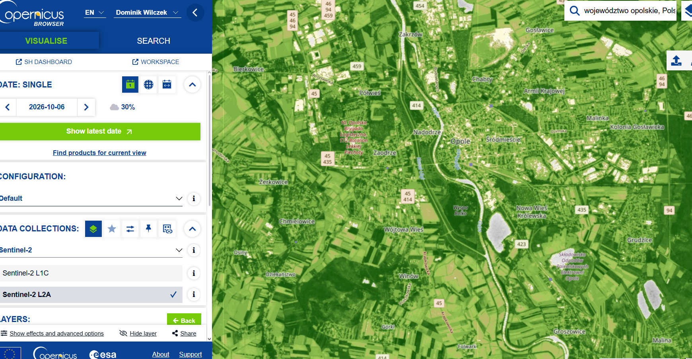

---

### 2. Pobranie danych

W zakładce **Analytical** okna pobierania wybrano format **TIFF (32-bit float)**, rozdzielczość **10 m/px** oraz układ współrzędnych **WGS 84 (EPSG:4326)**. Pobrano:

- warstwy wizualizowane: **True color** oraz **NDVI** – jako materiał referencyjny do późniejszego sprawdzenia poprawności obliczeń,
- warstwy surowe (**RAW**): kanały **B04** i **B08**, potrzebne do samodzielnego wyliczenia NDVI.

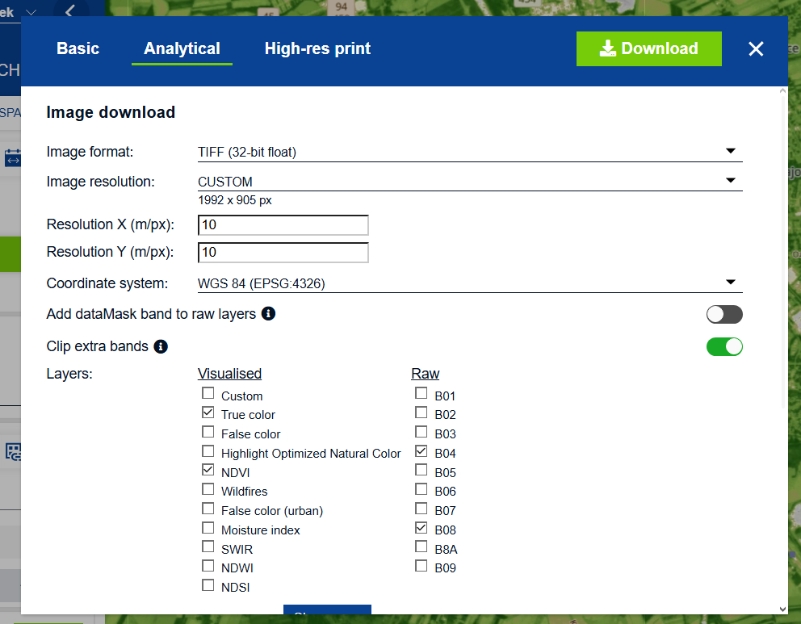

---

### 3. Zdjęcie True Color

Kompozycja w barwach naturalnych (kanały B04, B03, B02). Widoczne są zabudowa Opola, rzeka Odra z kanałem, zbiorniki wodne, lasy oraz mozaika pól uprawnych.

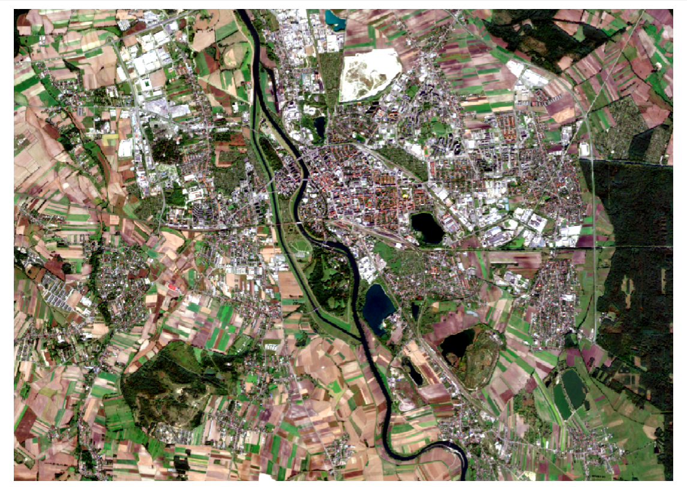

---

### 4. Oryginalne NDVI z Copernicus Browser

Gotowa warstwa NDVI wygenerowana przez platformę Copernicus. Posłuży jako punkt odniesienia do porównania z warstwą obliczoną samodzielnie.

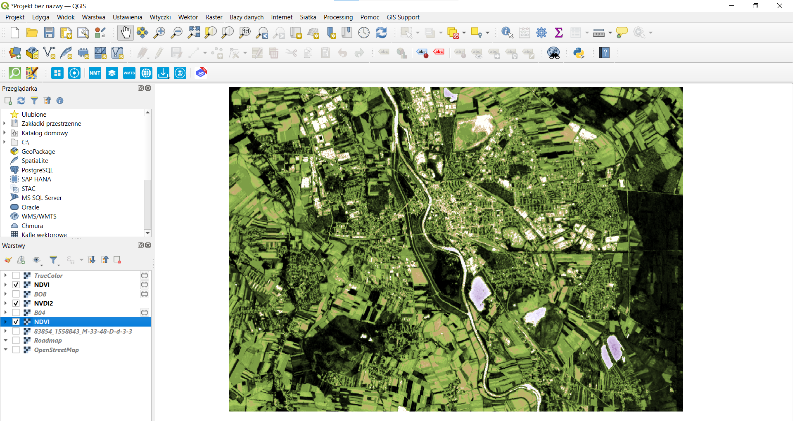

---

### 5. Wczytanie danych do QGIS

W programie **QGIS** wczytano pobrane pliki jako warstwy rastrowe, a ich nazwy zmieniono na czytelniejsze (`TrueColor`, `NDVI`, `B08`, `B04`). Panel warstw jest widoczny na zrzucie ekranu z punktu 4.

---

### 6. Warstwa NIR – kanał B08

Kanał **B08** Sentinel-2 to **bliska podczerwień (NIR)**, ok. 842 nm. Roślinność silnie odbija promieniowanie w tym zakresie, dlatego tereny zielone są jasne, a woda (która pochłania NIR) – niemal czarna.

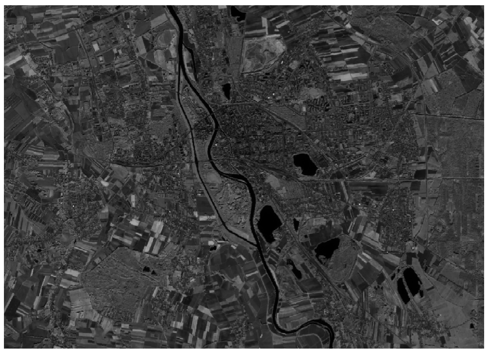

---

### 7. Warstwa RED – kanał B04

Kanał **B04** Sentinel-2 to **światło czerwone (RED)**, ok. 665 nm. Chlorofil silnie pochłania światło czerwone, więc roślinność jest w tym kanale ciemna, a jaśniejsze są obszary odsłoniętej gleby i zabudowy (np. składowisko odpadów w północnej części kadru).

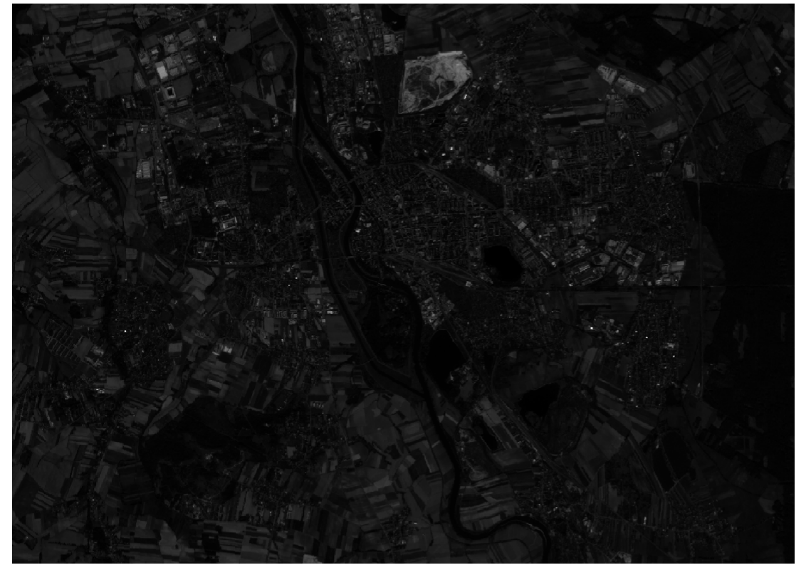

---

### 8. Obliczenie NDVI w Kalkulatorze rastra

Za pomocą narzędzia **Raster → Kalkulator rastra** obliczono znormalizowany różnicowy wskaźnik wegetacji (NDVI) z kanałów NIR i RED:

$$
NDVI = \frac{NIR - RED}{NIR + RED} = \frac{B08 - B04}{B08 + B04}
$$

Wyrażenie wpisane w kalkulatorze:

```
("B08@1" - "B04@1") / ("B08@1" + "B04@1")
```

Wartości NDVI mieszczą się w przedziale **od -1 do 1**:
- **< 0** – woda,
- **ok. 0 – 0,2** – gleba odsłonięta, zabudowa, drogi,
- **0,2 – 0,5** – roślinność rzadka lub słaba,
- **> 0,5** – gęsta, zdrowa roślinność (lasy, uprawy w pełni wegetacji).

---

### 9. Wynik – warstwa NDVI2

W wyniku obliczeń powstała nowa warstwa **NDVI2**, wyświetlona domyślnie w skali szarości. Jasne piksele oznaczają wysokie wartości NDVI (roślinność), ciemne – niskie (woda, zabudowa).

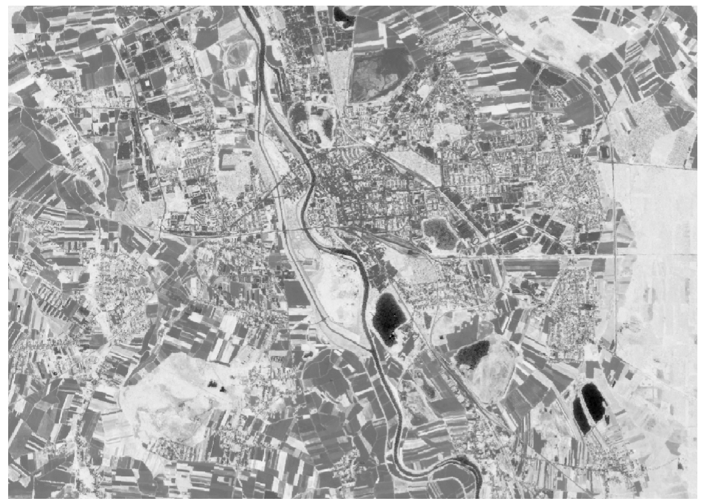

---

### 10. Nadanie stylu warstwie

W celu poprawy kontrastu i czytelności zmieniono styl warstwy NDVI2 na **pseudokolor jednopasmowy** z rampą kolorów od czerwieni do zieleni. Kolor czerwony oznacza wodę i obszary bez roślinności, pomarańczowy i jasnożółty – pola po zbiorach i zabudowę, a zielony – lasy, łąki i aktywne uprawy.

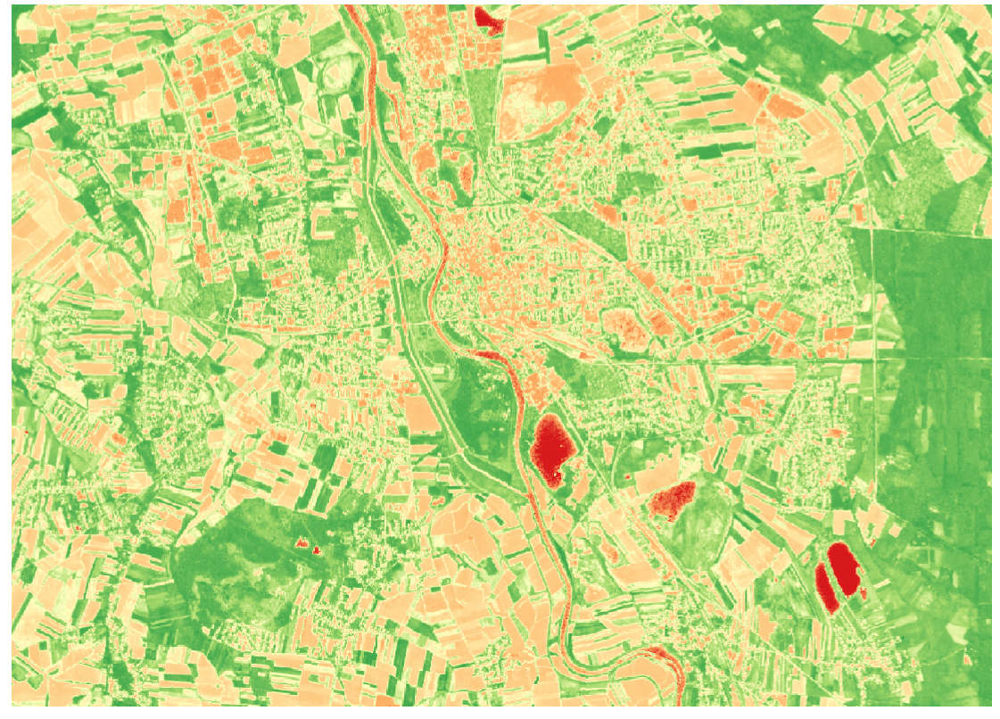

---

### 11. Podsumowanie

W ramach laboratorium pozyskano zobrazowanie Sentinel-2 L2A okolic Opola z dnia 06.10.2026 i samodzielnie obliczono wskaźnik NDVI w programie QGIS. Proces obejmował:

1. wyszukanie zobrazowania w Copernicus Browser,
2. pobranie warstw referencyjnych (True Color, NDVI) oraz surowych kanałów B04 (RED) i B08 (NIR),
3. wczytanie danych do QGIS,
4. obliczenie NDVI w Kalkulatorze rastra ze wzoru (B08 − B04) / (B08 + B04),
5. nadanie wynikowej warstwie stylu kolorystycznego.

Otrzymana warstwa NDVI2 jest zgodna z oryginalnym NDVI z Copernicus Browser – w obu wyraźnie widać te same obszary: lasy i tereny zielone o wysokich wartościach, pola po zbiorach i zabudowę miejską o wartościach niskich oraz zbiorniki wodne i Odrę o wartościach ujemnych. Potwierdza to poprawność przeprowadzonych obliczeń. Wskaźnik NDVI pozwala w prosty sposób oceniać kondycję i zasięg roślinności, co ma zastosowanie m.in. w rolnictwie, leśnictwie i planowaniu przestrzennym.

---

## Mapy wysokorozdzielcze – CIR

---

### 1. Pobranie ortofotomapy CIR z Geoportalu

Z serwisu **Geoportal** (geoportal.gov.pl) pobrano wysokorozdzielczą ortofotomapę fragmentu Opola (okolice Szczepanowic i Wójtowej Wsi) w wersji **CIR** (*Color InfraRed* – barwy podczerwone). Za pomocą narzędzia **Identyfikacja** wskazano arkusz i wybrano opcję *Pobierz plik danych dla tej sekcji*. Parametry pobranego arkusza:

- godło: **M-33-60-B-b-1-1**,
- kompozycja: **CIR**,
- aktualność: **22.04.2016**,
- wielkość piksela: **0,5 m**,
- układ współrzędnych: **PL-1992 (EPSG:2180)**,
- moduł archiwizacji: **1:5000**,
- źródło danych: zdjęcie cyfrowe, rozmiar pliku ok. 10 MB.

W kompozycji CIR kanały ułożone są następująco: **kanał 1 – NIR**, **kanał 2 – RED**, **kanał 3 – GREEN**.

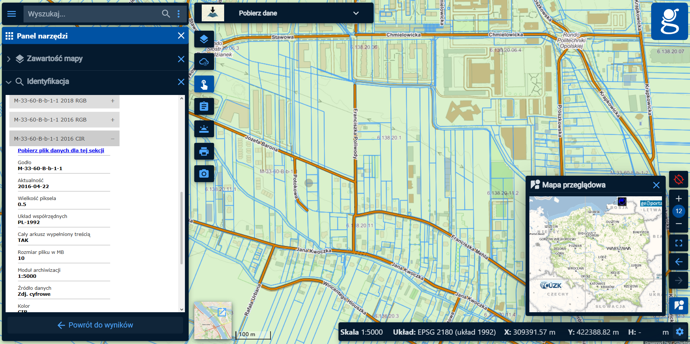

---

### 2. Podkład OpenStreetMap w QGIS

W programie **QGIS** jako mapę podkładową wczytano warstwę **OpenStreetMap**, przedstawiającą analizowany fragment Opola – dzielnice Szczepanowice, Zaodrze i Wójtowa Wieś, linię kolejową przy stacji Opole Zachodnie oraz Kanał Ulgi. Ułatwia to orientację w terenie i późniejszą interpretację wyników.

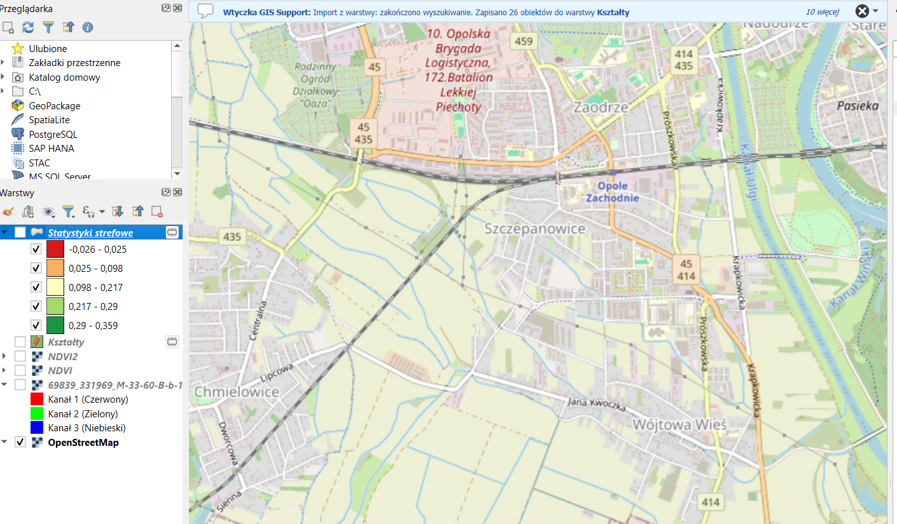

---

### 3. Nałożenie ortofotomapy CIR

Na podkład OSM nałożono pobrany plik CIR. QGIS domyślnie wyświetla kanał 1 (NIR) w kolorze czerwonym, dlatego **roślinność jest widoczna w odcieniach czerwieni i różu**, a zabudowa, drogi i odsłonięta gleba – w odcieniach szarości i błękitu. Dzięki rozdzielczości 0,5 m wyraźnie widać granice pojedynczych pól, budynki i ulice.

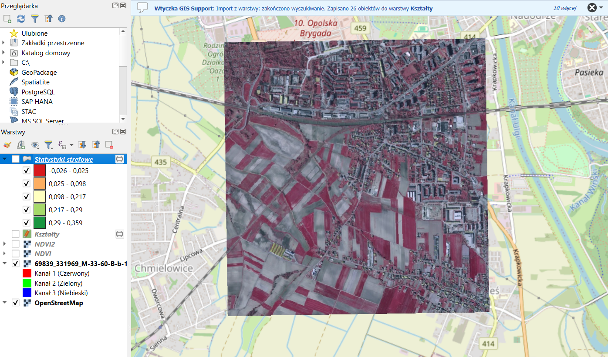

---

### 4. Obliczenie NDVI z ortofotomapy CIR

Za pomocą **Kalkulatora rastra** obliczono wskaźnik NDVI, wykorzystując kanały pobranej ortofotomapy CIR – **kanał 1 (NIR)** oraz **kanał 2 (RED)** – i podstawiając je do tego samego wzoru co w części dotyczącej Sentinel-2:

$$
NDVI = \frac{NIR - RED}{NIR + RED} = \frac{K1 - K2}{K1 + K2}
$$

Wyrażenie wpisane w kalkulatorze (gdzie `CIR` oznacza nazwę warstwy ortofotomapy):

```
("CIR@1" - "CIR@2") / ("CIR@1" + "CIR@2")
```

---

### 5. Wynik – warstwa NDVI z ortofotomapy CIR

Otrzymaną warstwę NDVI2 wyświetlono w stylu **pseudokolor jednopasmowy** z rampą od czerwieni do zieleni, z kontrastem ustawionym tak, by uwypuklić tereny zielone. Kolor zielony oznacza obszary pokryte aktywną roślinnością (uprawy ozime, łąki, zieleń przydomowa), a czerwony – odsłoniętą glebę, zabudowę, drogi i torowisko. Wysoka rozdzielczość pozwala rozróżnić zróżnicowanie wegetacji nawet w obrębie pojedynczych pól.

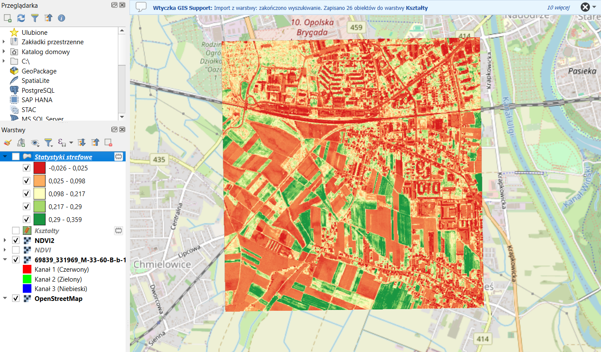

---

### 6. Pobranie granic działek – wtyczka GIS Support

Utworzono **warstwę tymczasową** (`Kształty`), na której narysowano poligon obejmujący wybrany fragment pól uprawnych. Następnie za pomocą wtyczki **GIS Support** pobrano dla tego obszaru dokładne granice **działek ewidencyjnych** znajdujących się w poligonie – wtyczka zapisała do warstwy **26 obiektów**.

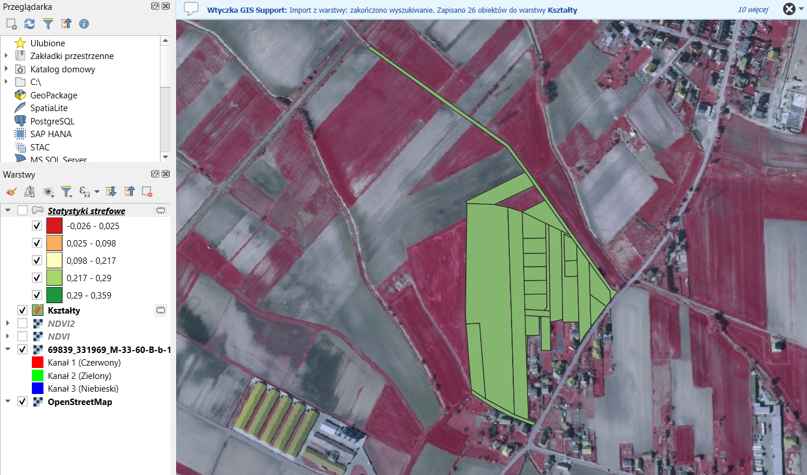

---

### 7. Średnie NDVI dla każdej działki – statystyki strefowe

Za pomocą narzędzia **Statystyki strefowe** obliczono dla każdej działki **średnią wartość NDVI** z pikseli rastra znajdujących się w jej granicach. Wynik sklasyfikowano w pięciu przedziałach:

| Kolor | Średnie NDVI | Interpretacja |
|---|---|---|
| czerwony | -0,026 – 0,025 | odsłonięta gleba, brak roślinności |
| pomarańczowy | 0,025 – 0,098 | bardzo słaba roślinność |
| jasnożółty | 0,098 – 0,217 | roślinność rzadka |
| jasnozielony | 0,217 – 0,29 | roślinność umiarkowana |
| ciemnozielony | 0,29 – 0,359 | najgęstsza roślinność w analizowanym obszarze |

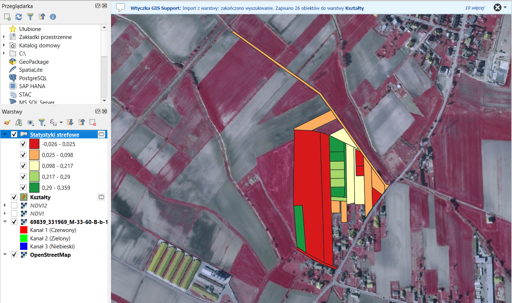

---

### 8. Porównanie z rastrem NDVI

Porównanie klasyfikacji działek z rastrem NDVI pokazuje dobrą zgodność: działki oznaczone na ciemnozielono odpowiadają zielonym fragmentom rastra, a duże działki oznaczone na czerwono – polom z odsłoniętą glebą, widocznym w kompozycji CIR jako szare. Średnie strefowe poprawnie oddają więc stan roślinności na poszczególnych działkach.

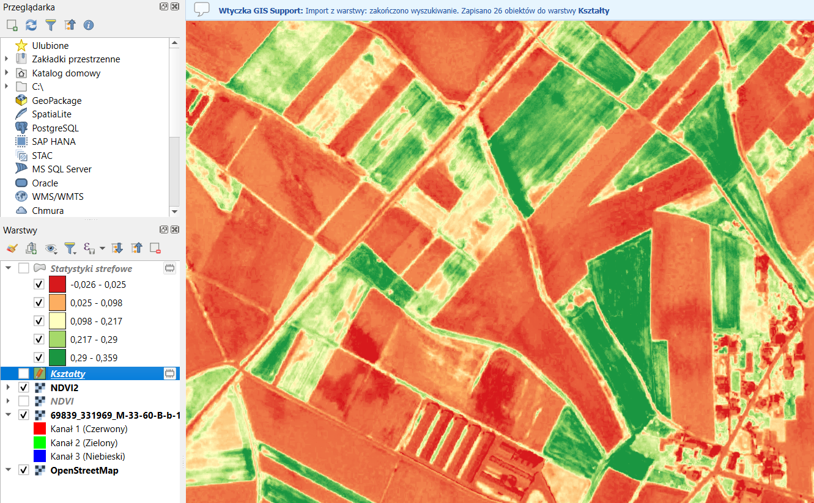

---

### 9. Podsumowanie

W tej części laboratorium wykorzystano wysokorozdzielczą ortofotomapę **CIR** z Geoportalu do obliczenia wskaźnika NDVI i oceny stanu roślinności na poziomie pojedynczych działek ewidencyjnych. Proces obejmował:

1. pobranie arkusza ortofotomapy CIR (0,5 m/px, 22.04.2016) z Geoportalu,
2. wczytanie podkładu OpenStreetMap i nałożenie na niego ortofotomapy w QGIS,
3. obliczenie NDVI w Kalkulatorze rastra z kanału 1 (NIR) i kanału 2 (RED),
4. nadanie wynikowej warstwie stylu kolorystycznego,
5. pobranie granic działek ewidencyjnych wtyczką GIS Support,
6. obliczenie średniego NDVI dla każdej działki narzędziem Statystyki strefowe.

W porównaniu z danymi Sentinel-2 (10 m/px) ortofotomapa CIR pozwala na znacznie dokładniejszą analizę – widoczne są pojedyncze budynki, miedze i zróżnicowanie wewnątrz pól. Zakres otrzymanych wartości NDVI (ok. -0,03 – 0,36) jest niższy niż dla Sentinel-2. Wynika to z wczesnowiosennego terminu zdjęcia (kwiecień, początek wegetacji, wiele pól bez roślinności) oraz z tego, że ortofotomapa zawiera wartości jasności pikseli bez kalibracji radiometrycznej i korekcji atmosferycznej. Wartości bezwzględne nie są więc bezpośrednio porównywalne z NDVI z Sentinel-2, natomiast względne różnice między obszarami są poprawnie odwzorowane. Połączenie NDVI z granicami działek umożliwia ocenę kondycji upraw na konkretnych parcelach, co ma zastosowanie m.in. w rolnictwie precyzyjnym i kontroli dopłat rolnych.
