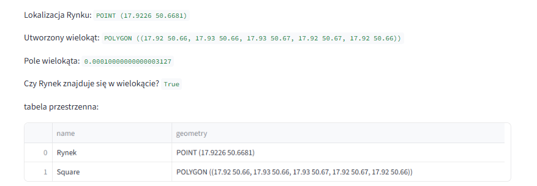
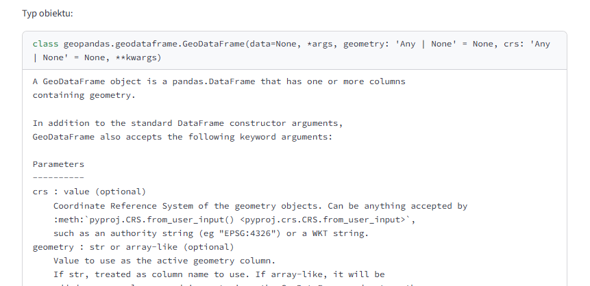
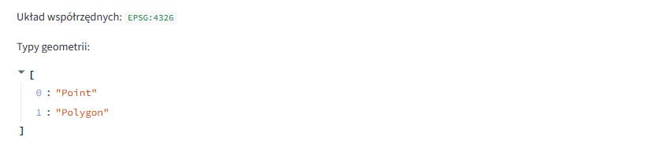
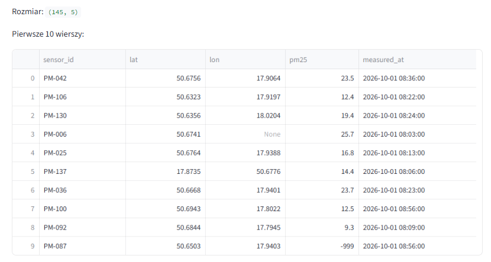
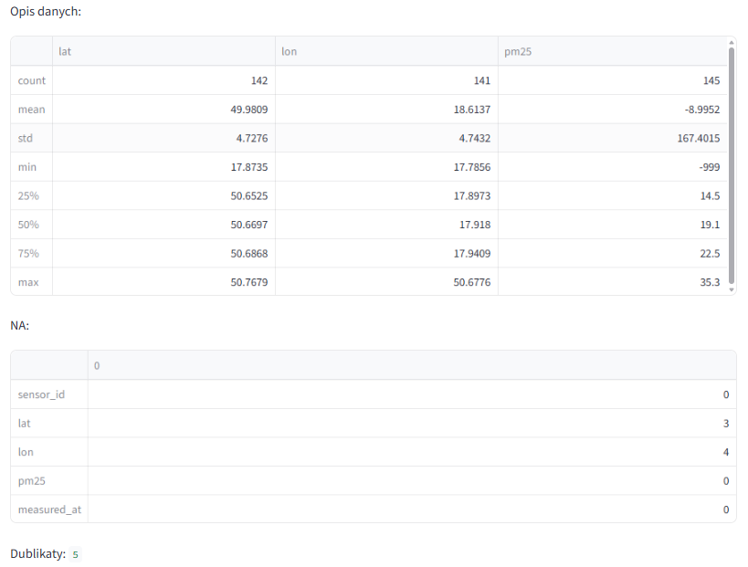
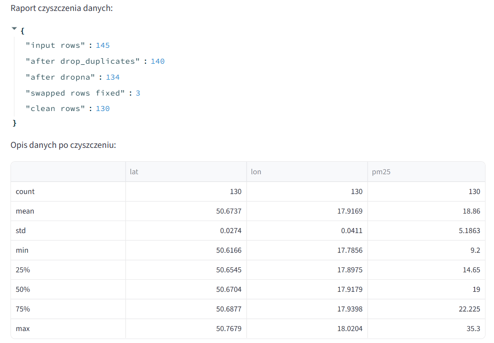
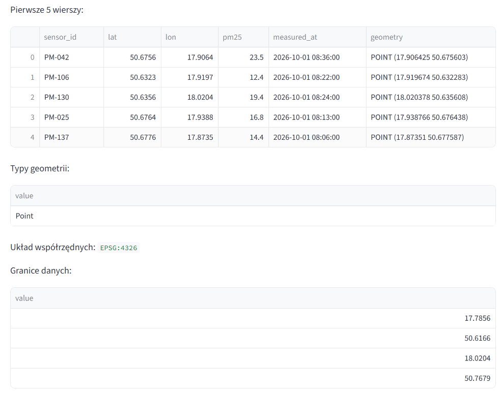
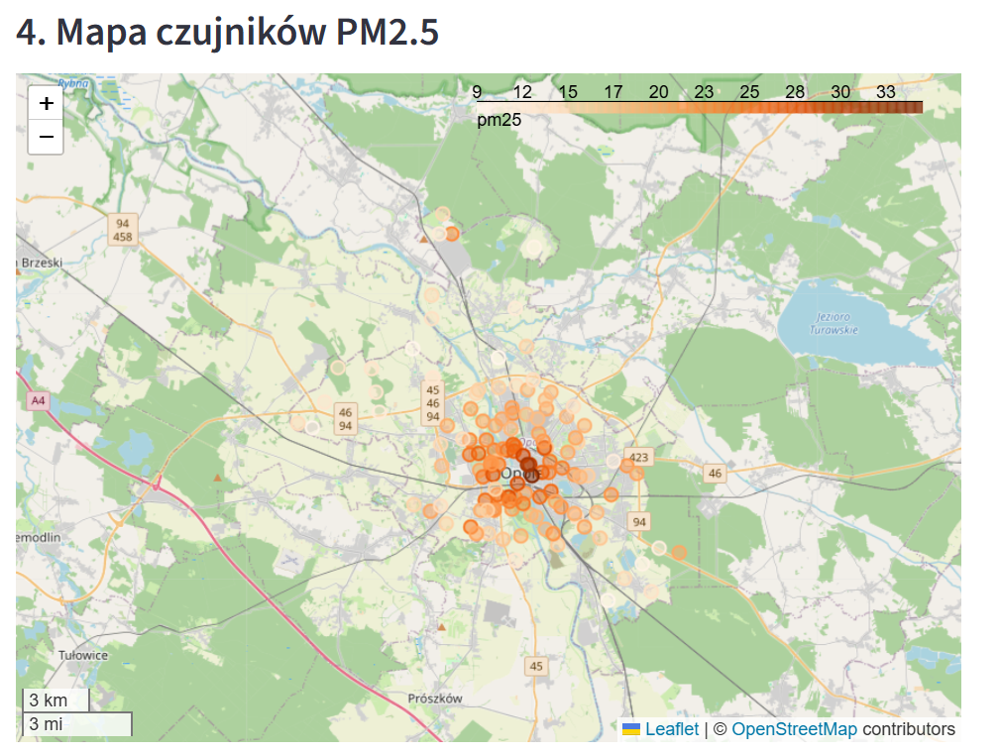

# Sprawozdanie -- ćwiczenie z GeoPandas

## 1. Cel ćwiczenia

Celem ćwiczenia było wczytanie, oczyszczenie i przedstawienie na mapie
danych o stężeniu PM2.5 w Opolu. Do wykonania zadania wykorzystano
Python, GeoPandas oraz aplikację Streamlit.

## 2. Przygotowanie środowiska

Projekt wykonano w aplikacji Streamlit, która pozwala wyświetlać tabele,
wyniki obliczeń i interaktywne mapy w przeglądarce.

Struktura katalogów:

``` text
lab_geo/
├── app.py
└── dane/
    └── pm25_sensors.csv
```

W terminalu, w katalogu `lab_geo`, wykonano polecenia:

``` bash
python -m venv .venv
source .venv/bin/activate              # Windows: .venv\Scripts\activate
pip install geopandas rasterio matplotlib mapclassify folium jupyter streamlit streamlit-folium
```

Kod aplikacji zapisano w pliku `app.py`. Aplikację uruchomiono
poleceniem:

``` bash
streamlit run app.py
```

Następnie otwarto adres wyświetlony w terminalu, zazwyczaj
`http://localhost:8501`.

## 3. Przebieg ćwiczenia

### A1. Geometria i GeoDataFrame

**Krok 1. Utworzenie punktu i wielokąta**

Kod:

``` python
from shapely.geometry import Point, Polygon

rynek = Point(17.9226, 50.6681)

square = Polygon([
    (17.92, 50.66),
    (17.93, 50.66),
    (17.93, 50.67),
    (17.92, 50.67)
])
```

**Wynik:**



Utworzono punkt reprezentujący Rynek w Opolu oraz
kwadrat zdefiniowany za pomocą czterech wierzchołków. Współrzędne punktu
podano w kolejności: najpierw długość geograficzna (X), a następnie
szerokość geograficzna (Y).

**Krok 2. Utworzenie GeoDataFrame**

Kod:

``` python
places = gpd.GeoDataFrame(
    {"name": ["Rynek", "Square"]},
    geometry=[rynek, square],
    crs="EPSG:4326"
)

places_display = places.copy()
places_display["geometry"] = places_display.geometry.to_wkt()
st.dataframe(places_display, use_container_width=True)

st.write("Układ współrzędnych:", places.crs)
st.write("Typy geometrii:", places.geom_type.tolist())
```

**Wynik:**




Utworzono GeoDataFrame zawierający punkt i wielokąt.
Przypisano mu układ współrzędnych EPSG:4326 (WGS 84). Typy geometrii to
Point i Polygon.

### A2. Wczytanie i analiza surowych danych

**Krok 1. Wczytanie pliku CSV**

Kod:

``` python
raw = pd.read_csv(
    "dane/pm25_sensors.csv",
    parse_dates=["measured_at"]
)

st.write("Rozmiar:", raw.shape)
st.write("Pierwsze 10 wierszy:", raw.head(10))
```

**Wynik:**


Wczytano dane pomiarowe z pliku `pm25_sensors.csv`.
Tabela zawiera 145 wierszy i 5 kolumn.

**Krok 2. Sprawdzenie statystyk danych, braków i duplikatów**

Kod:

``` python
st.write("Opis danych:", raw[["lat", "lon", "pm25"]].describe())

st.write("Braki danych:", raw.isna().sum())
st.write("Duplikaty:", raw.duplicated().sum())
```

**Wynik:**


Sprawdzono wartości minimalne, maksymalne, średnie i
odchylenia standardowe dla współrzędnych oraz pomiarów PM2.5. Zwrócono
uwagę na podejrzane wartości, w szczególności minimum `pm25` równe
`-999`. Jak widać na statystykach, zarówno `lat`, jak i `lon`
przyjmują wartości minimalne około 17 i maksymalne około 50. Opole
leży na szerokości geograficznej około 50,7°N i długości około 17,9°E.
Oznacza to, że w niektórych rekordach wartości `lat` i `lon` zostały
zamienione miejscami.
W danych wykryto 3 braki w kolumnie `lat`, 4 braki w
kolumnie `lon` oraz 5 zduplikowanych wierszy. Występowanie braków i
duplikatów oznacza, że dane wymagają oczyszczenia przed dalszą analizą.


### A3. Czyszczenie danych

Kod:

``` python
df = raw.copy()
report = {"input rows": len(df)}

# 1. Duplicates - the same message sent twice
df = df.drop_duplicates()
report["after drop_duplicates"] = len(df)

# 2. Rows without coordinates cannot be placed on a map
df = df.dropna(subset=["lat", "lon"])
report["after dropna"] = len(df)

# 3. Swapped coordinates: in Poland lat is 49-55 and lon is 14-24
swapped = df["lat"].between(14, 24.5) & df["lon"].between(49, 55)
df.loc[swapped, ["lat", "lon"]] = df.loc[swapped, ["lon", "lat"]].to_numpy()
report["swapped rows fixed"] = int(swapped.sum())

# 4. -999 is the sensor's error code, not a measurement
df = df[df["pm25"] >= 0].reset_index(drop=True)
report["clean rows"] = len(df)

st.write("Raport czyszczenia danych: ", report)
st.write("Opis danych po czyszczeniu: ", df[["lat", "lon", "pm25"]].describe())
```

**Wynik:**


Po wykonaniu czyszczenia liczba rekordów zmniejszyła się ze 145 do 130. Usunięto 5 duplikatów oraz 6 rekordów bez kompletnych współrzędnych. Wykryto i poprawiono 3 rekordy, w których zamieniono miejscami szerokość i długość geograficzną. Następnie usunięto pomiary oznaczone wartością -999, które stanowią kod błędu czujnika, a nie rzeczywisty wynik pomiaru. Jak widać w statystykach, po czyszczeniu wszystkie 130 rekordów ma poprawne współrzędne, które mieszczą się w przybliżeniu w zakresie 50,62–50,77 dla lat oraz 17,79–18,02 dla lon. Średnie stężenie PM2.5 wynosi około 18,86. Otrzymany zbiór danych jest gotowy do dalszej analizy przestrzennej i wyświetlenia na mapie.

### A4. Utworzenie GeoDataFrame i mapa czujników

Kod:

``` python
sensors = gpd.GeoDataFrame(
    df,
    geometry=gpd.points_from_xy(df["lon"], df["lat"]),
    crs="EPSG:4326",
)
st.write("Pierwsze 5 wierszy:", sensors.head())
st.write("Typy geometrii:", sensors.geom_type.unique())
st.write("Układ współrzędnych:", sensors.crs)
st.write("Granice danych:", sensors.total_bounds)
```

**Wynik:**


**Wyjaśnienie:**Oczyszczoną tabelę przekształcono w GeoDataFrame.
Funkcja `points_from_xy()` utworzyła punkty na podstawie współrzędnych.
Jako pierwszą podano długość geograficzną (`lon`), czyli X, a jako drugą
szerokość geograficzną (`lat`), czyli Y. Wszystkie obiekty mają geometrię typu Point, a układ
współrzędnych to EPSG:4326. Granice danych wynoszą w przybliżeniu
`[17.79, 50.62, 18.02, 50.77]`, co wskazuje na obszar Opola.

**Wyświetlenie mapy czujników PM2.5**

Kod:

``` python
sensor_map = sensors.explore(
    column="pm25",
    cmap="Oranges",
    marker_kwds={"radius": 6},
    tooltip=["pm25"]
)

st_folium(sensor_map, width=None, height=600)
```

**Wynik:**


Na mapie przedstawiono lokalizacje czujników PM2.5.
Kolor punktów zależy od wartości pomiaru, a po wskazaniu punktu można
odczytać wartość PM2.5. Wszystkie czujniki znajdują się na obszarze
Opola.

### Eksperyment -- zamiana współrzędnych

**Krok 1. Utworzenie GeoDataFrame z błędną kolejnością współrzędnych**

Kod:

``` python
sensors_wrong = gpd.GeoDataFrame(
    df,
    geometry=gpd.points_from_xy(
        df["lat"],
        df["lon"]
    ),
    crs="EPSG:4326"
)
```
Celowo zamieniono kolejność argumentów funkcji
`points_from_xy()`. Jako X przekazano `lat`, a jako Y `lon`. Jest to
niepoprawne dla współrzędnych geograficznych.

**Krok 2. Wyświetlenie mapy z błędnymi współrzędnymi**

Kod:

``` python
wrong_map = sensors_wrong.explore(
    column="pm25",
    cmap="Oranges",
    marker_kwds={"radius": 6},
    tooltip=["pm25"]
)

st_folium(wrong_map, width=None, height=600)
```

**Wynik:**

```{=html}
<!-- Wstaw zrzut ekranu z mapą po zamianie współrzędnych. -->
```
**Wyjaśnienie:** Po zamianie współrzędnych punkty nie znajdują się już w
Opolu. Zostały umieszczone w innym miejscu, ponieważ program potraktował
szerokość geograficzną jako długość, a długość jako szerokość.
Eksperyment pokazuje, jak ważna jest prawidłowa kolejność współrzędnych.

## 4. Wnioski

W ćwiczeniu poznano podstawy pracy z danymi przestrzennymi w GeoPandas.
Utworzono geometrie punktu i wielokąta, a następnie GeoDataFrame z
układem EPSG:4326. Wczytane dane PM2.5 sprawdzono i oczyszczono z
duplikatów, brakujących współrzędnych oraz błędnych pomiarów. Poprawiono
również trzy rekordy, w których zamieniono szerokość i długość
geograficzną.

Po oczyszczeniu danych utworzono punkty reprezentujące czujniki i
przedstawiono je na interaktywnej mapie w aplikacji Streamlit.
Eksperyment z zamianą współrzędnych potwierdził, że ich nieprawidłowa
kolejność powoduje błędne położenie obiektów na mapie.

Najważniejszy wniosek: przed analizą przestrzenną należy sprawdzić
jakość danych i upewnić się, że współrzędne są zapisane we właściwej
kolejności. Dla `points_from_xy()` w układzie EPSG:4326 należy podać
najpierw `lon` (X), a następnie `lat` (Y).
