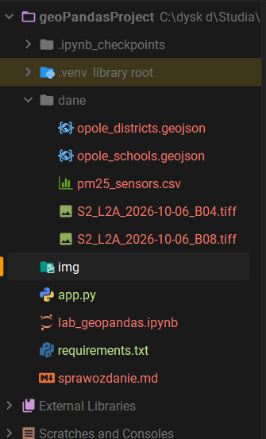
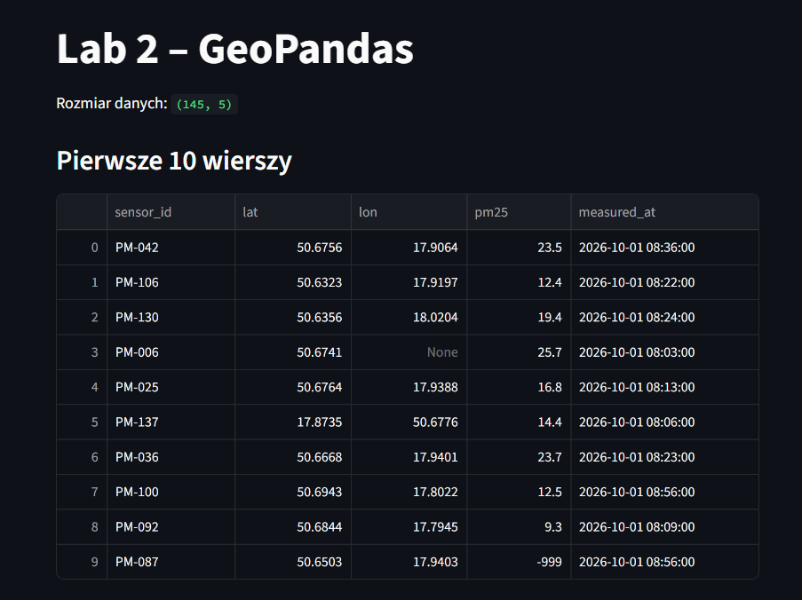
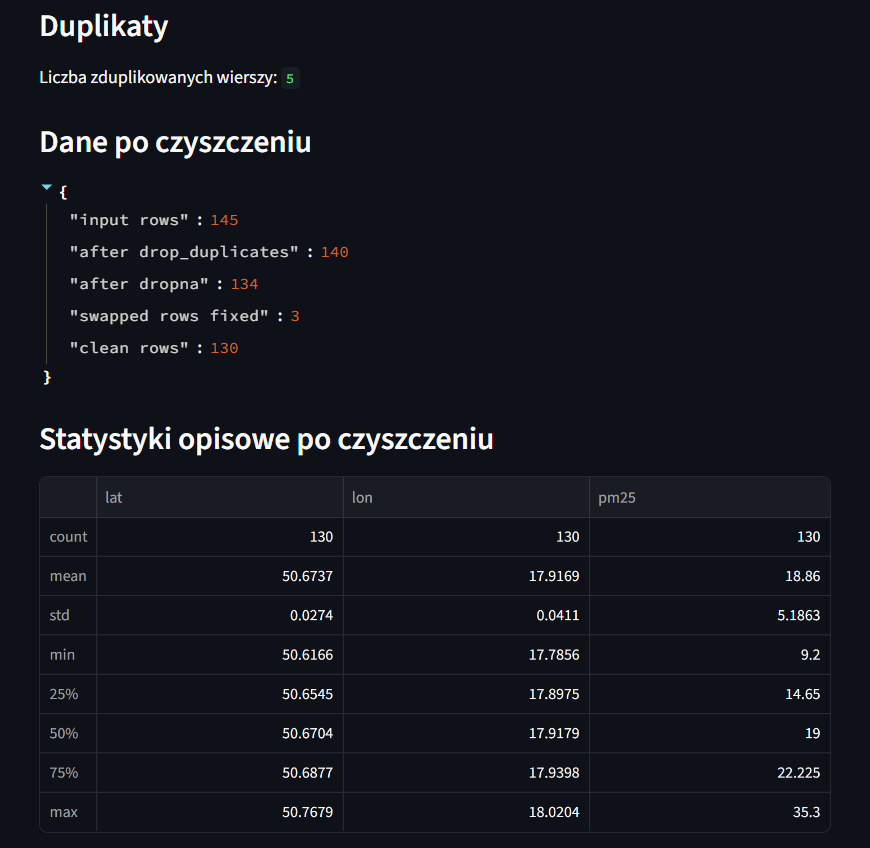
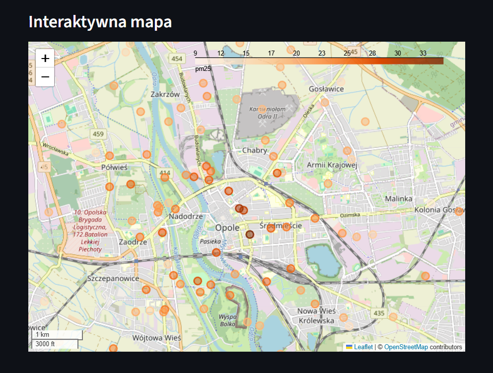
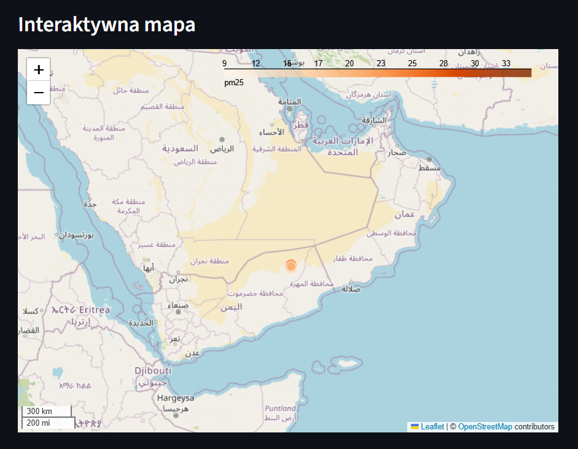

# Sprawozdanie — Laboratorium 2: Analiza danych przestrzennych
## Część A: GeoPandas — jakość powietrza (PM2.5) w Opolu

**Przedmiot:** Analiza danych przestrzennych
**Temat:** Wczytywanie, czyszczenie i wizualizacja danych przestrzennych w GeoPandas
**Dane wejściowe:** `pm25_sensors.csv`, `opole_districts.geojson`, `opole_schools.geojson`

---

## Cel ćwiczenia

Firma zewnętrzna dostarczyła plik CSV z odczytami PM2.5 z czujników rozmieszczonych w Opolu. Plik zawiera typowe błędy spotykane w danych "z terenu" (duplikaty, braki, zamienione współrzędne, kody błędów czujnika). Celem ćwiczenia jest:

1. Wczytanie i oczyszczenie danych tabelarycznych.
2. Przekształcenie ich w dane przestrzenne (`GeoDataFrame`).
3. Przygotowanie danych do odpowiedzi na pytania: *które dzielnice mają najgorsze powietrze?* i *jak wygląda sytuacja w pobliżu szkół?*

Kluczowa zasada przyjęta na początku ćwiczenia: **dane przestrzenne = zwykłe dane + geometria + układ współrzędnych (CRS)**, a każdy z tych trzech elementów może się zepsuć niezależnie od pozostałych.

---

## Krok 0. Przygotowanie środowiska

### 0.1. Struktura katalogów

Utworzono katalog roboczy projektu z podkatalogiem `dane/` zawierającym pliki od prowadzącego:

```
geoPandasProject/
└── dane/
    ├── pm25_sensors.csv
    ├── opole_districts.geojson
    ├── opole_schools.geojson
    ├── S2_L2A_2026-10-06_B04.tiff
    └── S2_L2A_2026-10-06_B08.tiff
```



### 0.2. Środowisko Pythona

Utworzono wirtualne środowisko i zainstalowano wymagane biblioteki:

```bash
python -m venv .venv
.venv\Scripts\activate          # Windows
pip install geopandas rasterio matplotlib mapclassify folium streamlit streamlit-folium
```

Zależności zapisano w `requirements.txt`, tak aby środowisko było odtwarzalne na innym komputerze (`pip install -r requirements.txt`).

Jako alternatywę dla Jupyter Notebooka, do zbudowania części interaktywnej wykorzystano **Streamlit** (`app.py`) — upraszcza to prezentację wyników (tabele, statystyki, mapa) bez potrzeby ręcznego odświeżania komórek notebooka.

**Komórka kontrolna — sprawdzenie wersji bibliotek:**

```python
import geopandas as gpd
import rasterio
import shapely

print("geopandas", gpd.__version__)
print("rasterio ", rasterio.__version__, "| GDAL", rasterio.__gdal_version__)
print("shapely  ", shapely.__version__)
```

**Wynik rzeczywisty:**

```
geopandas 1.2.0
rasterio  1.5.2 | GDAL 3.12.2
shapely   2.2.0
```

**Punkt kontrolny spełniony** — trzy wiersze z numerami wersji, bez błędów, GeoPandas ≥ 1.0.

---

## A1. Geometria i GeoDataFrame od zera

GeoPandas opiera się na `pandas` (tabele) i `Shapely` (geometrie). Zbudowano dwa podstawowe obiekty geometryczne — punkt (Rynek w Opolu) i wielokąt (przykładowy kwadrat) — i złożono je w `GeoDataFrame`:

```python
from shapely.geometry import Point, Polygon
import geopandas as gpd

rynek = Point(17.9226, 50.6681)          # (x, y) = (długość, szerokość geograficzna)
square = Polygon([(17.92, 50.66), (17.93, 50.66), (17.93, 50.67), (17.92, 50.67)])

places = gpd.GeoDataFrame(
    {"name": ["Rynek", "Square"]},
    geometry=[rynek, square],
    crs="EPSG:4326",                     # WGS 84 — stopnie dł./szer. geograficznej
)
```

**Wyniki:**

| Wielkość | Wartość |
|---|---|
| `places.crs` | `EPSG:4326` |
| `places.geom_type` | `Point`, `Polygon` |
| `square.area` | `0.0001` (stopnie²) |
| `square.contains(rynek)` | `True` |

**Punkt kontrolny spełniony** — `crs = EPSG:4326`, typy geometrii to `Point` i `Polygon`.



**Uwaga metodologiczna:** we współrzędnych geograficznych zawsze podaje się najpierw **x = długość geograficzna (lon)**, potem **y = szerokość geograficzna (lat)**. To odwrotnie niż w mowie potocznej ("szerokość, długość") — błąd na tym etapie jest jedną z najczęstszych przyczyn "czujników na złym kontynencie" (patrz A4).

---

## A2. Wczytanie surowych danych

Plik CSV wczytano jako zwykłą tabelę `pandas` — to **jeszcze nie są dane przestrzenne**, tylko tabela, w której dwie kolumny przypadkiem zawierają współrzędne:

```python
import pandas as pd

raw = pd.read_csv("dane/pm25_sensors.csv", parse_dates=["measured_at"])
```

Zgodnie z zasadą *"zanim cokolwiek policzysz, obejrzyj dane"* wykonano wstępną diagnostykę:

```python
raw[["lat", "lon", "pm25"]].describe()
raw.isna().sum()
raw.duplicated().sum()
```

**Wyniki rzeczywiste:**

- Rozmiar danych: **145 wierszy, 5 kolumn**
- `describe()`:

  | | lat | lon | pm25 |
  |---|---|---|---|
  | min | **17.87** | 17.79 | **-999.0** |
  | max | 50.77 | **50.68** | 35.3 |

- Braki danych: `lat` — 3, `lon` — 4, pozostałe kolumny — 0
- Liczba zduplikowanych wierszy: **5**

**Punkt kontrolny spełniony** — 145 wierszy/5 kolumn, min `pm25 = -999`, min `lat ≈ 17.87`, 3 braki w `lat`, 4 w `lon`, 5 duplikatów.

** Odpowiedź na pytanie kontrolne — skąd się wzięło `lat ≈ 17.9`, jeśli Opole leży na szerokości ~50,7°?**

Wartość `17.9` to w rzeczywistości poprawna **długość geograficzna** Opola — dla niektórych wierszy kolumny `lat` i `lon` zostały zamienione miejscami już w źródłowym pliku CSV (błąd po stronie dostawcy danych/czujnika). Stąd w kolumnie `lat` pojawiają się wartości typowe dla `lon` (ok. 17–18), a w `lon` wartości typowe dla `lat` (ok. 50–51, stąd też `max(lon) ≈ 50.68`).

---

## A3. Czyszczenie danych

Zidentyfikowano i naprawiono cztery problemy, licząc liczbę wierszy po każdym kroku (raport przebiegu czyszczenia):

```python
df = raw.copy()
report = {"input rows": len(df)}

# 1. Duplikaty — ten sam odczyt wysłany dwukrotnie
df = df.drop_duplicates()
report["after drop_duplicates"] = len(df)

# 2. Wiersze bez współrzędnych nie da się umieścić na mapie
df = df.dropna(subset=["lat", "lon"])
report["after dropna"] = len(df)

# 3. Zamienione współrzędne: w Polsce lat ∈ [49,55], lon ∈ [14,24]
swapped = df["lat"].between(14, 24.5) & df["lon"].between(49, 55)
df.loc[swapped, ["lat", "lon"]] = df.loc[swapped, ["lon", "lat"]].to_numpy()
report["swapped rows fixed"] = int(swapped.sum())

# 4. -999 to kod błędu czujnika, nie pomiar
df = df[df["pm25"] >= 0].reset_index(drop=True)
report["clean rows"] = len(df)
```

**Wynik rzeczywisty (raport czyszczenia):**

| Etap | Liczba wierszy |
|---|---|
| input rows | 145 |
| after drop_duplicates | 140 |
| after dropna | 134 |
| swapped rows fixed | 3 |
| **clean rows** | **130** |

Statystyki po czyszczeniu: `lat` ∈ [50.62, 50.77], `lon` ∈ [17.79, 18.02], `pm25` ∈ [9.2, 35.3], średnia `pm25 ≈ 18.9 µg/m³`.

**Punkt kontrolny spełniony** — przebieg 145 → 140 → 134 wierszy, 3 naprawione wiersze, 130 wierszy na końcu; zakresy `lat`/`pm25` zgodne z oczekiwanymi.

**Uwaga techniczna:** użycie `.to_numpy()` w kroku 3 jest konieczne — bez niego `pandas` dopasowałby wartości po nazwach kolumn (`lat`→`lat`, `lon`→`lon`) i przypisanie nie zamieniłoby niczego (zamiana "odwróciłaby się" samą siebie, czyli de facto nic by się nie zmieniło).

**Odpowiedź na pytanie kontrolne — dlaczego zamienione współrzędne naprawiono, a wiersze z `-999` usunięto?**

To dwa różne typy błędów:
- **Zamienione współrzędne** to błąd *odwracalny* — obie wartości są prawidłowymi pomiarami geograficznymi, tylko w złej kolumnie. Dane się nie zgubiły, więc wiersz można **naprawić**, zamieniając kolumny.
- **`-999`** to umowny **kod błędu czujnika** (sentinel value) oznaczający "brak prawidłowego odczytu" — nie reprezentuje żadnej rzeczywistej wartości PM2.5, więc nie da się go "naprawić" ani zinterpretować liczbowo. Jedyną poprawną reakcją jest **odrzucenie** takiego wiersza.


---

## A4. Z tabeli do GeoDataFrame

Dopiero po oczyszczeniu tabela została przekształcona w dane przestrzenne, z zachowaniem poprawnej kolejności współrzędnych (`x = lon`, `y = lat`):

```python
sensors = gpd.GeoDataFrame(
    df,
    geometry=gpd.points_from_xy(df["lon"], df["lat"]),   # x = lon, y = lat!
    crs="EPSG:4326",
)
```

**Wyniki rzeczywiste:**

| Wielkość | Wartość |
|---|---|
| `sensors.geom_type.unique()` | `['Point']` |
| `sensors.crs` | `EPSG:4326` |
| `sensors.total_bounds` | `[17.786, 50.617, 18.020, 50.768]` |

**Punkt kontrolny spełniony** — geometrie typu `Point`, CRS `EPSG:4326`, `total_bounds ≈ [17.79, 50.62, 18.02, 50.77]` — wszystkie wartości leżą w granicach Opola.

Szybki podgląd na interaktywnej mapie:

```python
sensors.explore(column="pm25", cmap="Oranges", marker_kwds={"radius": 6})
```



**Odpowiedź na pytanie kontrolne — co się stanie po zamianie argumentów `points_from_xy(df["lat"], df["lon"])`?**

Sprawdzono eksperymentalnie — zamiana argumentów daje:

```
total_bounds (zamienione): [50.617, 17.786, 50.768, 18.020]
```

Ponieważ GeoPandas zawsze interpretuje pierwszy argument jako `x` (długość geograficzną) a drugi jako `y` (szerokość geograficzną), podanie `lat` jako `x` i `lon` jako `y` przenosi wszystkie punkty do współrzędnych *(x ≈ 50.6–50.8°E, y ≈ 17.8–18.0°N)*. To lokalizacja na **Półwyspie Arabskim** (okolice Jemenu/Arabii Saudyjskiej) — **ok. 4000 km od Opola**. Czujniki "wylądowały" po drugiej stronie kontynentu, mimo że dane liczbowe się nie zmieniły — zmieniła się tylko ich interpretacja jako współrzędnych.



---

## Podsumowanie

Przeprowadzone ćwiczenie pokazało, że surowe dane "z terenu" wymagają weryfikacji na trzech niezależnych poziomach: wartości (duplikaty, braki, kody błędów typu `-999`), geometrii (poprawna kolejność `x, y`) i układu współrzędnych (CRS). Każdy z tych elementów może zawierać błąd niezależnie od pozostałych, a połączenie ich w jeden `GeoDataFrame` nie gwarantuje, że dane są poprawne przestrzennie — gwarantuje tylko, że mają właściwy *format*.

Zestaw 145 surowych odczytów PM2.5 został doprowadzony do 130 wiarygodnych punktów pomiarowych poprzez usunięcie duplikatów i wierszy bez współrzędnych, naprawienie trzech przypadków zamienionych kolumn `lat`/`lon` oraz odrzucenie odczytów oznaczonych kodem błędu `-999`. Finalny zbiór `sensors` ma poprawny typ geometrii (`Point`), układ `EPSG:4326` i zasięg zgodny z granicami Opola, co stanowi solidną podstawę do dalszych analiz (porównania między dzielnicami, odległości od szkół).

Ćwiczenie z celowym odwróceniem `x`/`y` w kroku A4 dodatkowo potwierdziło główny wniosek całego laboratorium: błąd w kolejności współrzędnych **nie powoduje awarii programu**, tylko **ciche, błędne umiejscowienie danych na mapie** — a to jest znacznie trudniejsze do wykrycia niż błąd zgłoszony wyjątkiem, dlatego wymaga świadomej weryfikacji (np. przez `total_bounds` lub szybki podgląd `.explore()`) na każdym etapie pracy z danymi przestrzennymi.
